# Rota Inteligente — Otimização de Entregas com Algoritmos de IA

> Projeto acadêmico da disciplina **Artificial Intelligence Fundamentals** (UniFECAF) para a empresa fictícia **Sabor Express**, delivery de comida na região central de São Paulo.

A cidade vira um **grafo**; os pedidos são agrupados em zonas com **K-Means**; cada trecho é calculado com **A\***; a ordem de visita é melhorada com **2-opt**; e as zonas são distribuídas entre os entregadores pelo **algoritmo húngaro**. A solução é comparada, com as mesmas métricas, à rota manual usada hoje e à heurística do vizinho mais próximo.

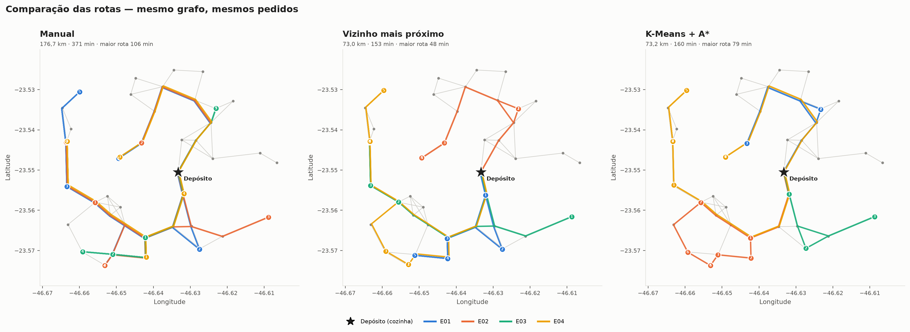

**Status:** núcleo de IA completo (Etapas 1–7). A API, o banco e o aplicativo web estão planejados para as próximas etapas.

## Sumário

[Problema](#problema) · [Objetivo](#objetivo) · [Arquitetura](#arquitetura) · [Tecnologias](#tecnologias) · [Estrutura](#estrutura-de-pastas) · [Como executar](#como-executar) · [Algoritmos](#algoritmos) · [Grafo](#diagrama-do-grafo) · [Resultados](#resultados) · [Resultados visuais](#resultados-visuais) · [Como interpretar](#como-interpretar-os-resultados) · [Análise](#análise-dos-resultados) · [Limitações](#limitações) · [Melhorias](#melhorias-futuras) · [Testes](#testes) · [Lint](#lint) · [CI](#integração-contínua-ci) · [Vídeo](#vídeo-pitch) · [Licença](#licença)

## Problema

Nos horários de pico (almoço e jantar), a Sabor Express distribui os pedidos e define os trajetos manualmente, pela experiência dos entregadores. O resultado são rotas que cruzam a cidade, atrasos, mais combustível e clientes insatisfeitos.

## Objetivo

Sugerir rotas mais curtas, rápidas e baratas:

- **Grafo:** nós = cozinha (depósito) e bairros; arestas = ruas, com peso em km ou minutos.
- **Menor caminho** entre dois pontos com **A\*** (heurística Haversine).
- **Agrupamento** dos pedidos em zonas com **K-Means**, uma zona por entregador.
- **Comparação** honesta entre três estratégias: rota manual, vizinho mais próximo e K-Means + A\*.

## Arquitetura

```text
data/*.csv ──> rota_core (núcleo de IA) ──> outputs/ (mapas, gráficos, report.md, comparison.csv)
                 data → domain → graph → algorithms → services → reporting

Próximas etapas:  PWA Next.js ──HTTP──> API FastAPI ──> rota_core
                                            └──> PostgreSQL
```

O núcleo é independente: não conhece API, banco nem interface. Detalhes em [docs/architecture.md](docs/architecture.md).

## Tecnologias

| Uso | Tecnologia |
| --- | --- |
| Linguagem | Python 3.11+ |
| Grafo e caminhos | NetworkX (estrutura do grafo e validação com Dijkstra); A\* implementado no projeto |
| Agrupamento | scikit-learn (`KMeans`, `silhouette_score`) |
| Atribuição | SciPy (`linear_sum_assignment`, algoritmo húngaro) |
| Dados | pandas, Pydantic v2, pydantic-settings |
| Visualização | matplotlib (mapas e gráficos; sem Google Maps nem APIs pagas) |
| Qualidade | pytest, ruff, GitHub Actions |

## Estrutura de pastas

```text
rota-inteligente/
├── README.md
├── Makefile                    # atalhos: install, lint, test, report...
├── .env.example                # configurações de exemplo (sem segredos)
├── data/                       # CSVs fictícios: nodes, edges, orders, couriers
├── core/                       # núcleo de IA (pacote rota-core)
│   ├── pyproject.toml
│   └── rota_core/
│       ├── config.py           # configurações (pydantic-settings)
│       ├── cli.py              # python -m rota_core ...
│       ├── data/               # leitura, validação e geração dos CSVs
│       ├── domain/             # Node, Edge, Order, Courier, Route, Zone, Metrics...
│       ├── graph/              # grafo NetworkX e Haversine
│       ├── algorithms/         # astar, assignment (snap + húngaro), manual,
│       │                       # nearest_neighbor, kmeans_zones, two_opt,
│       │                       # kmeans_astar, routing (cache e matriz de custos)
│       ├── services/           # optimizer, metrics, benchmark
│       ├── reporting/          # maps, charts, report, style
│       └── tests/              # 172 testes pytest
├── outputs/                    # resultados gerados (versionados)
│   ├── maps/                   # 6 mapas
│   ├── charts/                 # 7 gráficos
│   ├── comparison.csv
│   └── report.md               # relatório técnico completo
├── docs/                       # architecture.md, algorithms.md, results.md, video-script.md
├── backend/  frontend/         # API e PWA (próximas etapas)
└── .github/workflows/ci.yml
```

## Como executar

Requisitos: Python 3.11 ou superior. `make` é opcional.

```bash
git clone <url-do-repositorio> rota-inteligente
cd rota-inteligente
python -m venv .venv
source .venv/bin/activate          # Windows: .venv\Scripts\activate
pip install -e "core[dev]"          # ou: make install
```

Gerar todos os resultados (mapas, gráficos, `comparison.csv` e `report.md` em `outputs/`):

```bash
python -m rota_core report                     # ou: make report
python -m rota_core run --strategy all --report
```

Outros comandos:

| Comando | O que faz |
| --- | --- |
| `python -m rota_core run --strategy all` | Executa as 3 estratégias e mostra rotas e comparação no terminal |
| `python -m rota_core run --strategy kmeans_astar` | Uma estratégia (`manual`, `nearest_neighbor`, `kmeans_astar`) |
| `python -m rota_core benchmark --seeds 30` | Compara as estratégias em 30 datasets gerados |
| `python -m rota_core generate-data` | Recria os CSVs de `data/` (seed 42) |
| `python -m rota_core validate-data` | Valida colunas, depósito único e conectividade |

Opções comuns: `--weight distance_km|time_min` (otimizar por distância ou tempo), `--k 4` (número de zonas), `--seed 42` (`random_state` do K-Means), `--max-extra 2` (folga do balanceamento), `--output-dir outputs`, `--benchmark-seeds 30` (0 desliga o teste de robustez do relatório).

Sem instalar nada no computador: abra o repositório no **GitHub Codespaces** e rode os mesmos comandos no terminal do navegador.

## Algoritmos

| Etapa | Algoritmo | Papel |
| --- | --- | --- |
| 1 | **Snap** (Haversine) | Liga cada pedido ao nó mais próximo do grafo |
| 2 | **K-Means** | Agrupa os pedidos em k zonas pela posição (coordenadas convertidas em km) |
| 3 | **Balanceamento** | Nenhuma zona passa de `ceil(n/k) + 2` pedidos; nenhuma fica vazia |
| 4 | **Vizinho mais próximo** | Ordem inicial de visita dentro da zona |
| 5 | **2-opt** | Inverte trechos para desfazer cruzamentos; só aceita melhoria |
| 6 | **Algoritmo húngaro** | Zona → entregador, minimizando km × custo/km |
| 7 | **A\*** | Menor caminho em cada trecho, com cache por (origem, destino, peso) |

- **A\***: expande o nó de menor `f(n) = g(n) + h(n)`. A heurística `h` é a distância em linha reta (Haversine) até o destino; para tempo, ela é dividida pela velocidade máxima da malha. Nunca superestima, porque nenhuma rua é mais curta que a linha reta, então o caminho é ótimo. Validado contra o Dijkstra em 250 pares para cada peso.
- **K-Means**: com `n_init=10` e `random_state=42`, o resultado é determinístico. O k usado é o número de entregadores; cotovelo e silhueta (k = 2 a 8) estão nos gráficos.
- **Baselines**: *manual* = pedidos em ordem de chegada, distribuídos em rodízio; *vizinho mais próximo* = cotas iguais, cada entregador vai sempre ao pedido livre mais próximo.

Explicação completa, com admissibilidade, garantias e limitações de cada algoritmo: [docs/algorithms.md](docs/algorithms.md).

## Diagrama do grafo

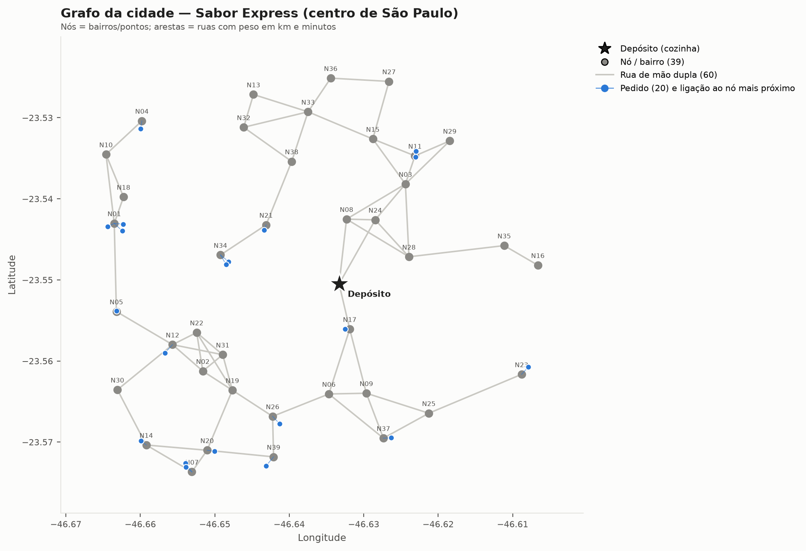

40 nós (1 depósito na Praça da Sé + 39 pontos), 60 ruas de mão dupla (57,3 km), velocidades de 20, 30 e 40 km/h. Os 20 pedidos (em azul) aparecem ligados ao nó mais próximo. Todos os dados são fictícios e gerados com seed fixa.

## Resultados

Dataset oficial: 20 pedidos e 4 entregadores, otimização por distância (`python -m rota_core report`). A rota manual é a referência. "Redução de X%" = a estratégia gastou menos (melhor); "aumento de X%" = gastou mais (pior).

| Estratégia | km | min | R$ | ETA médio (min) | Maior rota (min) | Desvio de carga | km vs manual |
| --- | ---: | ---: | ---: | ---: | ---: | ---: | ---: |
| Manual | 176,71 | 371,3 | 59,60 | 45,4 | 105,5 | 0,00 | referência |
| Vizinho mais próximo | 73,02 | 153,4 | 23,86 | 15,7 | 47,7 | 0,00 | redução de 58,7% |
| K-Means + A\* | 73,22 | 160,0 | 19,73 | 15,6 | 78,8 | 2,00 | redução de 58,6% |

Robustez: média de 30 datasets sintéticos (`python -m rota_core benchmark --seeds 30`).

| Estratégia | km | min | R$ | Maior rota (min) | km vs vizinho mais próximo |
| --- | ---: | ---: | ---: | ---: | ---: |
| Manual | 126,25 | 289,3 | 47,95 | 94,4 | aumento de 82,7% |
| Vizinho mais próximo | 69,09 | 157,1 | 22,65 | 65,5 | referência |
| K-Means + A\* | 64,67 | 147,6 | 21,30 | 55,5 | redução de 6,4% |

No `comparison.csv`, os campos `gain_vs_manual_km`, `gain_vs_manual_min` e `gain_vs_manual_cost` seguem a mesma convenção: **valor positivo = redução** de km, tempo ou custo em relação à rota manual; valor negativo = aumento. Tabelas completas, rotas de cada entregador e tempo de cálculo: [outputs/report.md](outputs/report.md).

## Resultados visuais

Todas as imagens são geradas por `python -m rota_core report` em `outputs/`.

### Mapas


*As três estratégias lado a lado, na mesma escala. A rota manual cruza a cidade; as otimizadas ficam em regiões.*

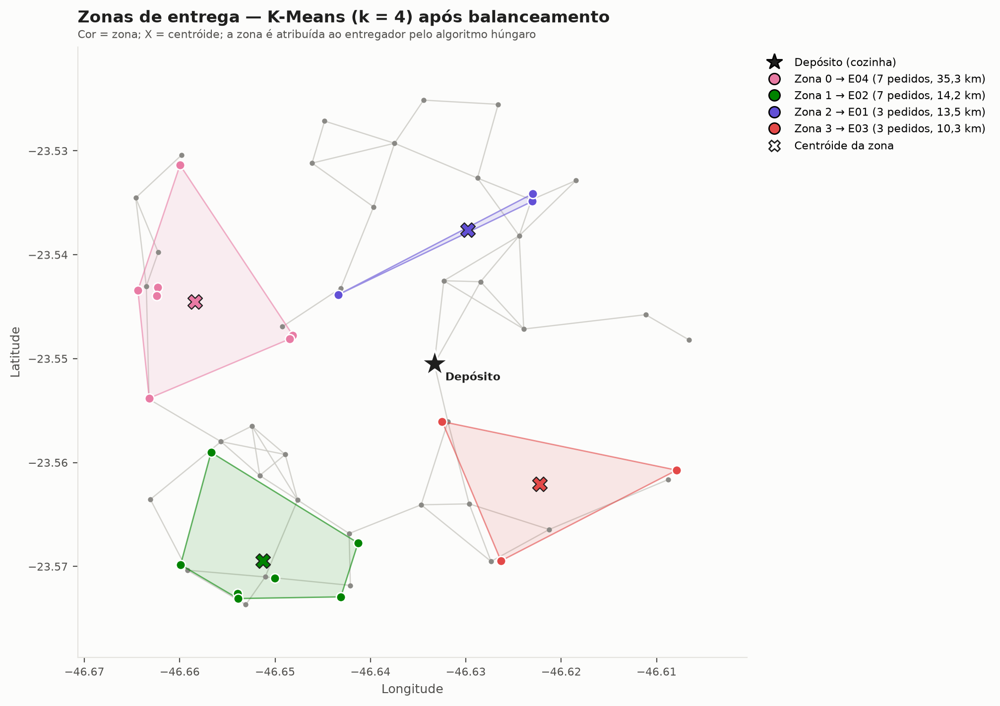

*Zonas do K-Means após o balanceamento: cor = zona, X = centróide. A zona 0 (oeste) parece perto do depósito, mas é a mais cara pelas ruas.*

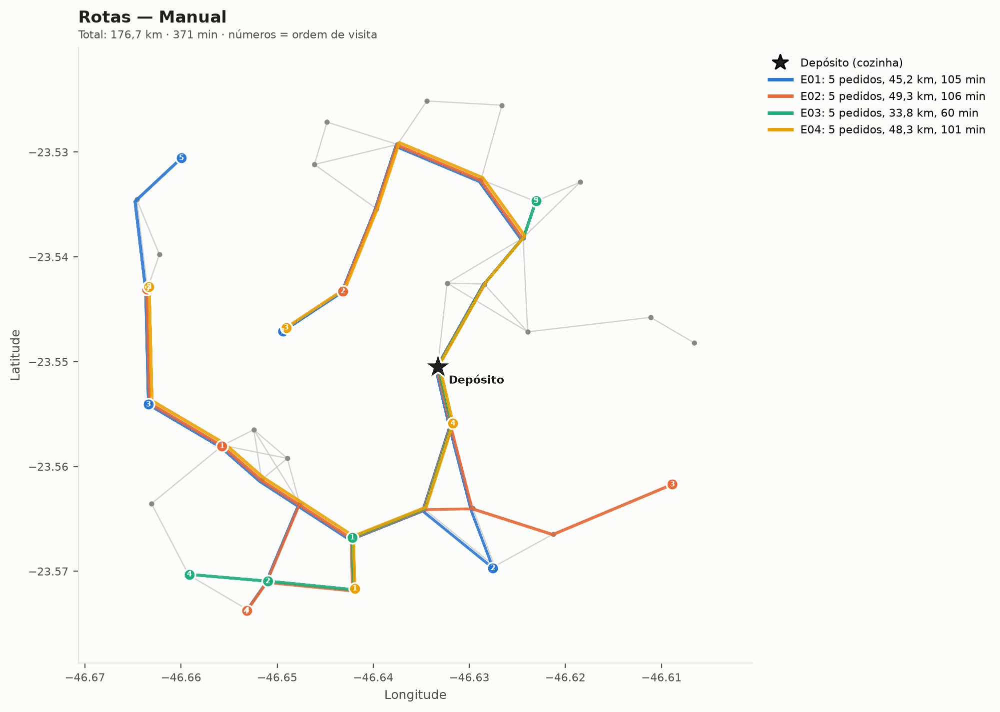

*Rota manual: pedidos divididos em rodízio pela ordem de chegada (176,7 km). Os números indicam a ordem de visita.*

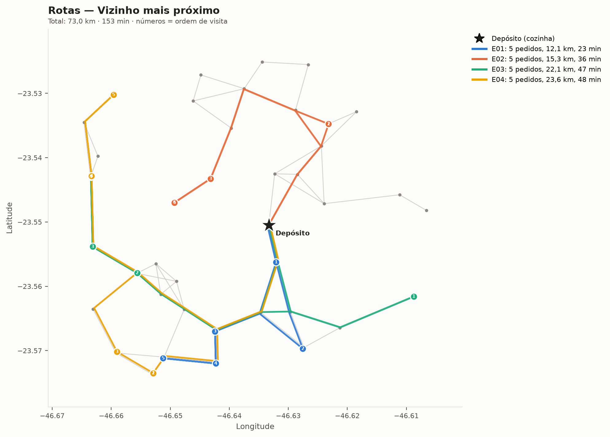

*Vizinho mais próximo: cada entregador vai sempre ao pedido livre mais próximo (73,0 km).*

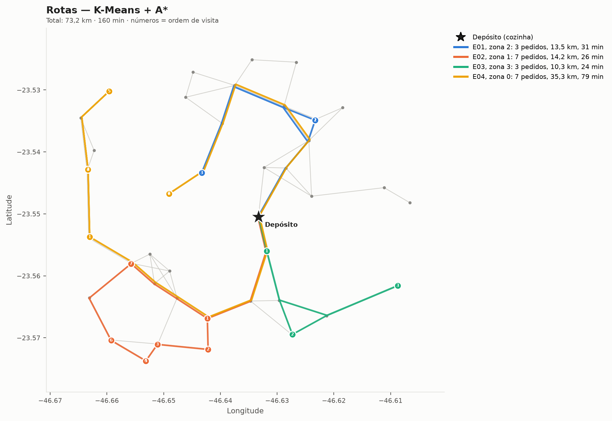

*K-Means + A\*: uma zona por entregador, ordem melhorada pelo 2-opt e trechos pelo A\* (73,2 km).*

### Gráficos

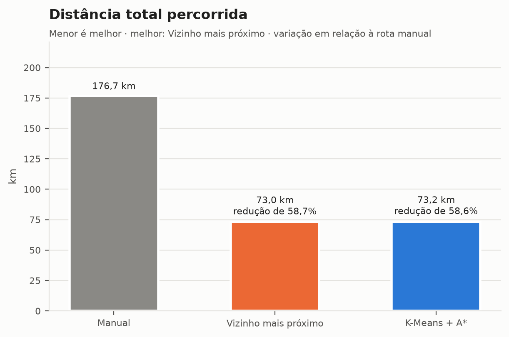

*Distância total por estratégia e redução em relação à rota manual.*

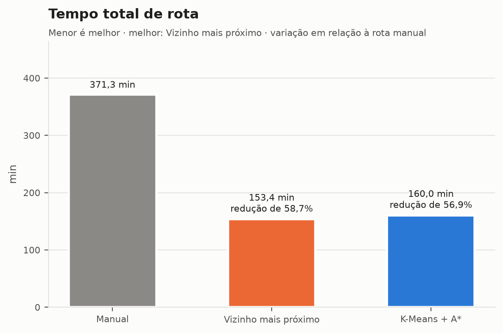

*Tempo total de rota por estratégia.*

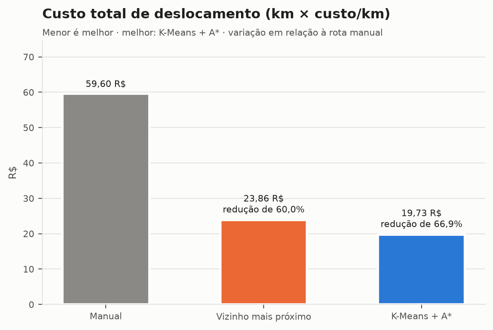

*Custo em R$ (km × custo/km). O K-Means + A\* é o mais barato por causa da atribuição húngara, não por percorrer menos.*

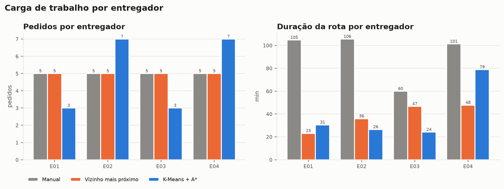

*Pedidos e minutos por entregador: o mesmo número de pedidos não significa o mesmo trabalho.*

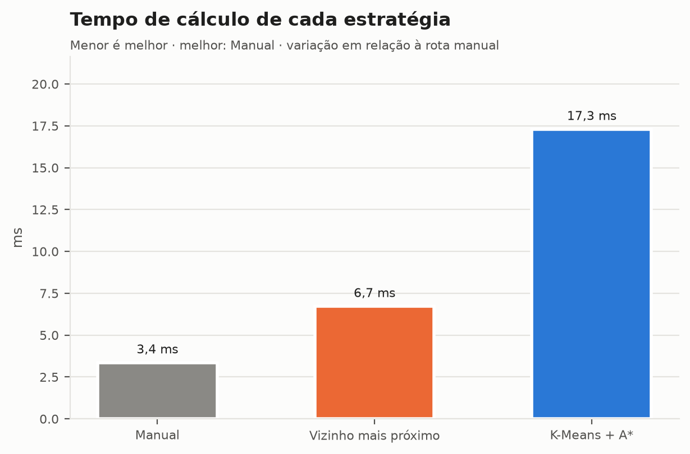

*Tempo de cálculo de cada estratégia, em milissegundos (varia entre execuções).*

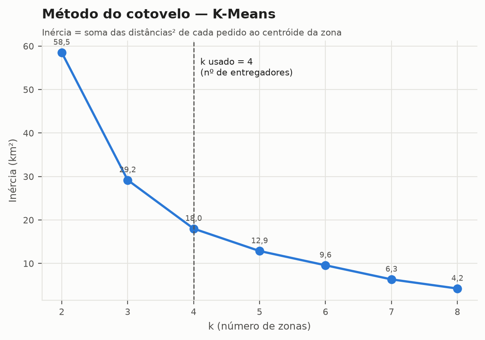

*Inércia do K-Means para k = 2 a 8: a queda da inércia diminui depois de k = 4.*

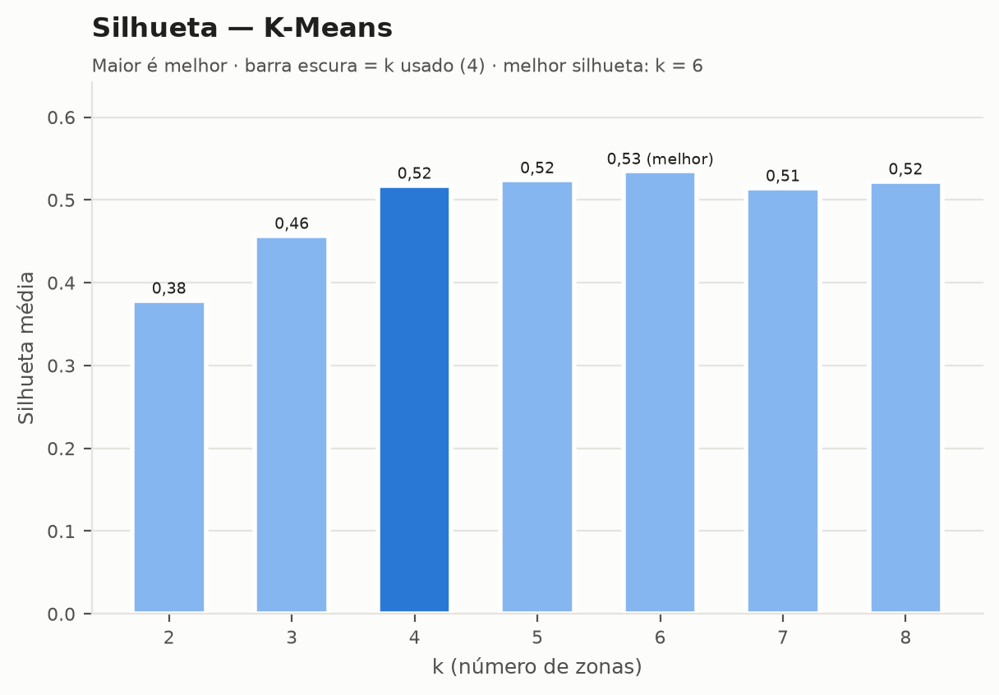

*Silhueta para k = 2 a 8: k = 4 (usado) tem 0,52; a melhor é 0,53, com k = 6.*

## Como interpretar os resultados

- **Dataset oficial × média de 30 datasets.** O dataset oficial (seed 42) é um cenário único: mostra rotas concretas, mas pode favorecer uma estratégia por acaso. A média de 30 datasets (seeds 1 a 30) mostra a tendência. Neste projeto os dois resultados diferem, e os dois são verdadeiros: no oficial, o K-Means + A\* empata com o vizinho mais próximo em km e perde na maior rota; na média, vence.
- **Os dados do benchmark são sintéticos.** As 30 cidades vêm do mesmo gerador (pontos aleatórios no centro de São Paulo, ruas fictícias, velocidades fixas). A média mostra o comportamento nesse tipo de cenário, não garante o resultado numa cidade real.
- **O K-Means + A\* não vence em todos os cenários.** Ele percorre menos km que o vizinho mais próximo em 22 de 30 datasets. Perde quando a proximidade em linha reta não corresponde à proximidade pelas ruas, como na zona 0 do dataset oficial.
- **A atribuição húngara reduz custo, mas não necessariamente km ou tempo.** Ela decide quem percorre cada zona, minimizando km × custo/km. Os km de uma zona são os mesmos, seja quem for o entregador, e no modelo todos os veículos têm a mesma velocidade. Por isso, trocar entregadores entre zonas muda o R$, mas não o km nem os minutos.
- **"Redução" e "aumento"** são sempre em relação à referência indicada (rota manual ou vizinho mais próximo). Valores positivos de `gain_vs_manual_*` no CSV significam redução.

## Análise dos resultados

1. **Otimizar faz muita diferença:** as duas estratégias otimizadas têm redução de cerca de 58% no km em relação à rota manual, e o ETA médio por pedido cai de 45 para 16 min.
2. **No dataset oficial, o K-Means + A\* não vence o vizinho mais próximo.** Em relação a ele, tem aumento de 0,3% em km (empate prático), aumento de 4,3% em tempo e aumento de 65,1% na maior rota (78,8 contra 47,7 min). Ele é o mais barato em R$ (redução de 17,3%), pela atribuição húngara.
3. **Por que perde aqui:** a zona 0 fica a 1,5 km do depósito em linha reta, mas a 6,6 km pelas ruas (4,3×), porque não há rua direta. O K-Means agrupa por linha reta e não enxerga a malha viária.
4. **Na média de 30 datasets sintéticos, o K-Means + A\* é a melhor estratégia:** em relação ao vizinho mais próximo, tem redução de 6,4% em km e de 15,2% na maior rota, e percorre menos km em 22 de 30 cenários. Melhor em média, não em todos os casos.
5. **O 2-opt nunca piora**, mas ganha pouco com zonas pequenas: melhorou 33 de 120 zonas nos 30 datasets (redução de 1,4% do km dessas rotas).

Análise detalhada, incluindo quando cada estratégia é melhor: [docs/results.md](docs/results.md).

## Limitações

- O K-Means agrupa por proximidade geográfica e **não conhece a malha viária** nem a posição do depósito.
- Velocidades fixas por rua: sem trânsito real, semáforos ou variação por horário.
- O veículo não muda a velocidade; a atribuição húngara afeta só o custo em R$.
- Sem capacidade de carga nem janelas de horário (os campos existem no modelo, mas ainda não são usados).
- Grafo sintético e pequeno (40 nós), com dados fictícios.
- O balanceamento conta pedidos, não a duração das rotas.

## Melhorias futuras

1. Considerar o depósito e as ruas no agrupamento (método *sweep* ou K-Medoids sobre a matriz de custos A\*).
2. Trocas de pedidos entre zonas após o roteamento, balanceando pela duração.
3. Escolher k pelo custo total, em vez de fixar k = número de entregadores.
4. Capacidade, prioridade e janelas de horário (VRP com restrições).
5. Malha real do OpenStreetMap e velocidades por horário.
6. Camada web: API FastAPI, PostgreSQL e PWA para gestor e entregador (já planejada).

## Testes

```bash
cd core
pytest              # 172 testes
pytest -k astar     # só os testes do A*
```

| Arquivo | Cobre |
| --- | --- |
| `test_data.py` | Leitura, colunas, determinismo e consistência dos CSVs |
| `test_graph.py` | Grafo, Haversine e conectividade |
| `test_astar.py` | A* = Dijkstra em 250 pares; heurística admissível e consistente; mão única; erros |
| `test_baselines.py` | Snap, matriz de custos com cache, rota manual e vizinho mais próximo |
| `test_kmeans_astar.py` | K-Means, balanceamento, húngaro (contra força bruta), 2-opt e rotas finais |
| `test_reporting.py` | Métricas, rankings, mapas, gráficos, `report.md`, `comparison.csv` e CLI |
| `test_algorithms.py`, `test_metrics.py` | Verificações rápidas e modelo de métricas |

## Lint

```bash
cd core
ruff check .            # ou: make lint
ruff format --check .
```

## Integração contínua (CI)

O workflow [`.github/workflows/ci.yml`](.github/workflows/ci.yml) roda a cada push e pull request na `main`, em Python 3.11 e 3.12:

1. Instala o núcleo com as dependências de desenvolvimento.
2. `ruff check .`
3. `pytest` (inclui a geração de mapas, gráficos e relatório numa pasta temporária).
4. `python -m rota_core validate-data`.

## Vídeo pitch

Roteiro de 4 minutos (problema, solução, algoritmos, demonstração, resultados, limitações e conclusão), com falas, imagens e comandos: [docs/video-script.md](docs/video-script.md).

Link do vídeo: *(adicionar após publicar no YouTube)*

## Licença

MIT — uso acadêmico. Dados 100% fictícios; nenhum dado pessoal real.
