# Relatório — Rota Inteligente (Sabor Express)

Gerado por `python -m rota_core report` em 2026-11-12 · peso de otimização: `distance_km` · `random_state` do K-Means: 42

## 1. Objetivo

Sugerir rotas de entrega mais curtas, rápidas e baratas para a Sabor Express, que hoje divide os pedidos e define os trajetos manualmente. A cidade é tratada como um **grafo**. Três estratégias são comparadas com as mesmas métricas: a rota manual (como é feito hoje), o vizinho mais próximo e o K-Means + A*.

## 2. Metodologia

1. Carregar e validar os CSVs (nós, ruas, pedidos, entregadores).
2. Montar o grafo dirigido (cada rua de mão dupla vira dois arcos) e ligar cada pedido ao nó mais próximo (*snap* por Haversine).
3. Executar cada estratégia num grafo novo, com o cache de A* vazio, medindo o tempo de cálculo.
4. Calcular métricas por rota e por estratégia; comparar com a rota manual.
5. Repetir as três estratégias em 30 datasets gerados (teste de robustez).

Condições iguais para todas: mesmo grafo, mesmos pedidos e entregadores, mesmo A* (validado contra o Dijkstra), mesmo peso.

## 3. O grafo

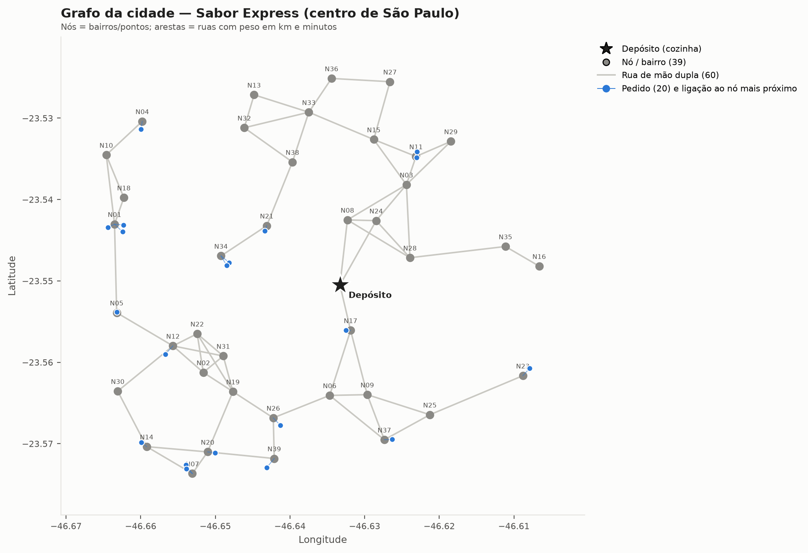

- **40 nós:** 1 depósito (a cozinha, Praça da Sé) e 39 bairros/pontos no centro de São Paulo.
- **60 ruas de mão dupla** (120 arcos), somando 57,3 km.
- **Peso de cada aresta:** distância em km (linha reta × fator de desvio de 1,15 a 1,40) e tempo em minutos = distância / velocidade × 60, com velocidades de 20, 30, 40 km/h.
- O grafo é conexo: todo ponto é alcançável a partir do depósito.

## 4. Os dados

| Arquivo | Conteúdo |
| --- | --- |
| `nodes.csv` | 40 nós (`id, name, kind, lat, lon`); depósito `N00` |
| `edges.csv` | 60 ruas (`source, target, distance_km, speed_kmh, oneway`) |
| `orders.csv` | 20 pedidos fictícios, de 11:33 a 12:17 (pico do almoço) |
| `couriers.csv` | 4 entregadores ativos: E01 (moto, R$ 0,42/km), E02 (moto, R$ 0,41/km), E03 (moto, R$ 0,46/km), E04 (bike, R$ 0,10/km) |

Todos os dados são fictícios e gerados com seed fixa; nenhum dado pessoal real.

## 5. Algoritmos

**A\*** — menor caminho entre dois nós expandindo sempre o nó de menor `f(n) = g(n) + h(n)`, em que `g` é o custo já percorrido e `h` é a estimativa do que falta. A heurística é a distância Haversine até o destino (peso em km) ou essa distância dividida pela velocidade máxima da malha (peso em minutos). Ela nunca superestima, porque nenhuma rua é mais curta que a linha reta, então o caminho é ótimo. Validado contra o Dijkstra em 250 pares para cada peso.

**K-Means** — agrupa os pedidos em k = 4 zonas pela posição (latitude/longitude convertidas em km). Cada pedido vai para o centróide mais próximo; os centróides são recalculados até estabilizar (`n_init=10`, `random_state=42`). Com k = 4 (número de entregadores), a silhueta é 0,52; a maior silhueta é 0,53, com k = 6. O k usado segue a frota disponível, não o ótimo geométrico: cada zona precisa de um entregador.

**Balanceamento** — o K-Means não controla o tamanho dos grupos. Nenhuma zona pode passar de `ceil(n/k) + 2` pedidos; o excedente sai pelos pedidos "de borda", que estão quase tão perto de uma zona vizinha. Nenhuma zona fica vazia. Zonas finais: zona 0: 7, zona 1: 7, zona 2: 3, zona 3: 3 pedidos (limite 7).

**Atribuição húngara** — cada zona vai para um entregador diferente, minimizando o custo total: `km da zona × custo/km do entregador`. A solução ótima vem do `scipy.optimize.linear_sum_assignment`.

**Vizinho mais próximo + 2-opt** — dentro de cada zona, a ordem inicial vai sempre ao pedido mais próximo (custo A*). O 2-opt inverte trechos da sequência para desfazer cruzamentos e só aceita uma troca se o custo total da rota diminuir. Logo, nunca piora a rota.

**Baselines** — *manual*: pedidos em ordem de chegada, distribuídos em rodízio, visitados na ordem de chegada. *Vizinho mais próximo*: cotas iguais por entregador; cada um sai do depósito e vai sempre ao pedido livre mais próximo.

## 6. Resultados

### Tabela comparativa

| Estratégia | km | min | R$ | ETA médio (min) | Maior rota (min) | Desvio de carga | Tempo de cálculo (ms) | km vs manual | min vs manual | R$ vs manual |
| --- | ---: | ---: | ---: | ---: | ---: | ---: | ---: | ---: | ---: | ---: |
| Manual | 176,71 | 371,3 | 59,60 | 45,4 | 105,5 | 0,00 | 3,4 | referência | referência | referência |
| Vizinho mais próximo | 73,02 | 153,4 | 23,86 | 15,7 | 47,7 | 0,00 | 6,7 | redução de 58,7% | redução de 58,7% | redução de 60,0% |
| K-Means + A* | 73,22 | 160,0 | 19,73 | 15,6 | 78,8 | 2,00 | 17,3 | redução de 58,6% | redução de 56,9% | redução de 66,9% |

Variação em relação à rota manual: "redução" = a estratégia é melhor; "aumento" = é pior. ETA = minutos desde a saída do depósito até a chegada ao pedido. Desvio de carga = desvio-padrão do número de pedidos por entregador. O tempo de cálculo varia entre execuções.

### Rankings

| Critério | 1º | 2º | 3º |
| --- | --- | --- | --- |
| Menor distância | Vizinho mais próximo | K-Means + A* | Manual |
| Menor tempo | Vizinho mais próximo | K-Means + A* | Manual |
| Menor custo | K-Means + A* | Vizinho mais próximo | Manual |
| Melhor balanceamento | Manual | Vizinho mais próximo | K-Means + A* |

### Rotas por estratégia

**Manual**

| Entregador | Zona | Pedidos | km | min | R$ | ETA médio (min) |
| --- | ---: | ---: | ---: | ---: | ---: | ---: |
| E01 | — | 5 | 45,24 | 104,7 | 19,00 | 53,3 |
| E02 | — | 5 | 49,31 | 105,5 | 20,22 | 55,6 |
| E03 | — | 5 | 33,80 | 59,9 | 15,55 | 25,8 |
| E04 | — | 5 | 48,35 | 101,2 | 4,83 | 46,9 |

**Vizinho mais próximo**

| Entregador | Zona | Pedidos | km | min | R$ | ETA médio (min) |
| --- | ---: | ---: | ---: | ---: | ---: | ---: |
| E01 | — | 5 | 12,11 | 23,1 | 5,09 | 9,4 |
| E02 | — | 5 | 15,28 | 35,9 | 6,26 | 11,8 |
| E03 | — | 5 | 22,07 | 46,6 | 10,15 | 25,8 |
| E04 | — | 5 | 23,56 | 47,7 | 2,36 | 15,7 |

**K-Means + A\***

| Entregador | Zona | Pedidos | km | min | R$ | ETA médio (min) |
| --- | ---: | ---: | ---: | ---: | ---: | ---: |
| E01 | 2 | 3 | 13,47 | 30,5 | 5,66 | 8,1 |
| E02 | 1 | 7 | 14,21 | 26,5 | 5,83 | 9,6 |
| E03 | 3 | 3 | 10,26 | 24,2 | 4,72 | 6,8 |
| E04 | 0 | 7 | 35,28 | 78,8 | 3,53 | 28,6 |

## 7. Interpretação

1. **Otimizar vale muito.** Em relação à rota manual, o vizinho mais próximo tem redução de 58,7% em km e o K-Means + A*, redução de 58,6%. O ETA médio por pedido cai de 45,4 min para 15,7 e 15,6 min. A rota manual cruza a cidade porque divide os pedidos pela ordem de chegada, não pela posição.
2. **Neste dataset, K-Means + A* e vizinho mais próximo empatam em distância** (aumento de 0,3% em km para o K-Means + A*). Em tempo total, o K-Means + A* tem aumento de 4,3%.
3. **A rota mais longa é pior no K-Means + A*** (78,8 contra 47,7 min, aumento de 65,1%). A zona mais cara é a **zona 0** (7 pedidos, 35,3 km, entregador E04). Em linha reta, o pedido mais próximo dela fica a 1,5 km do depósito; pelas ruas, a 6,6 km (4,3× mais, contra 1,4–2,2× nas outras zonas). A zona parece perto no mapa, mas não há ligação direta pelas ruas: é exatamente o que o K-Means não enxerga, porque agrupa por linha reta.
4. **Custo:** o mais barato é K-Means + A* (R$ 19,73). No K-Means + A*, a atribuição húngara entrega a zona mais longa ao entregador com menor custo por km. Como o modelo não muda a velocidade por veículo, isso reduz o custo em R$, mas não o km nem o tempo: os km de cada zona são os mesmos, seja quem for o entregador.
5. **Balanceamento:** desvio de pedidos por entregador de 0,00 (vizinho, cotas fixas) e 2,00 (K-Means). O K-Means aceita zonas desiguais (até a média + 2 pedidos) em troca de zonas compactas. Número igual de pedidos não significa trabalho igual: a carga real aparece em minutos no gráfico de carga.
6. **Um dataset não basta.** Na média de 30 datasets sintéticos, o K-Means + A* tem redução de 6,4% em km e redução de 15,2% na maior rota em relação ao vizinho mais próximo. Ele percorre menos km em 22 de 30 datasets e tem a maior rota mais curta em 24 de 30. Conclusão: **é a melhor estratégia em média, mas não em todos os casos**. Perde quando a proximidade em linha reta não corresponde à proximidade pelas ruas, ou quando uma zona compacta tem acesso difícil a partir do depósito.

### Robustez

As três estratégias foram executadas em 30 datasets gerados com seeds 1 a 30 (outra cidade e outros pedidos em cada um), peso `distance_km`.

| Estratégia (média) | km | min | R$ | ETA médio (min) | Maior rota (min) |
| --- | ---: | ---: | ---: | ---: | ---: |
| Manual | 126,25 | 289,3 | 47,95 | 36,9 | 94,4 |
| Vizinho mais próximo | 69,09 | 157,1 | 22,65 | 16,2 | 65,5 |
| K-Means + A* | 64,67 | 147,6 | 21,30 | 15,0 | 55,5 |

K-Means + A* com menos km que o vizinho mais próximo: **22 de 30**. Com maior rota mais curta: **24 de 30**.

## 8. Mapas

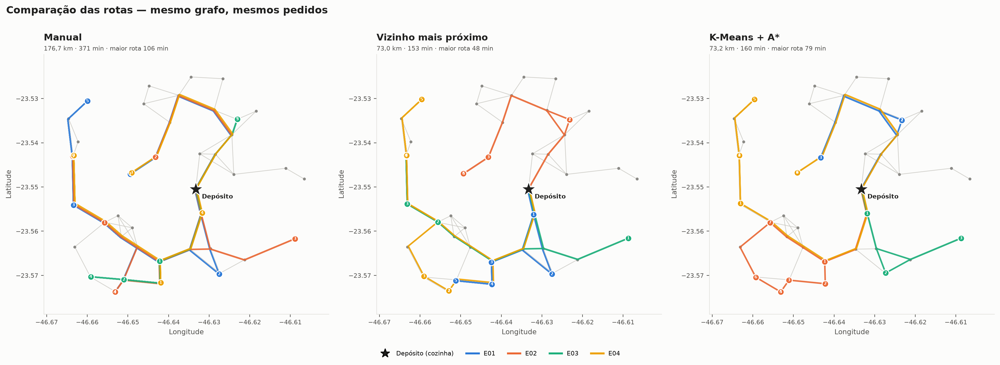

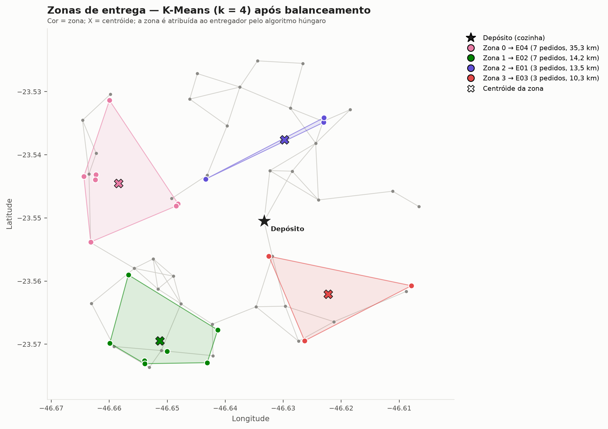

| Rota manual | Vizinho mais próximo | K-Means + A* |
| --- | --- | --- |
| 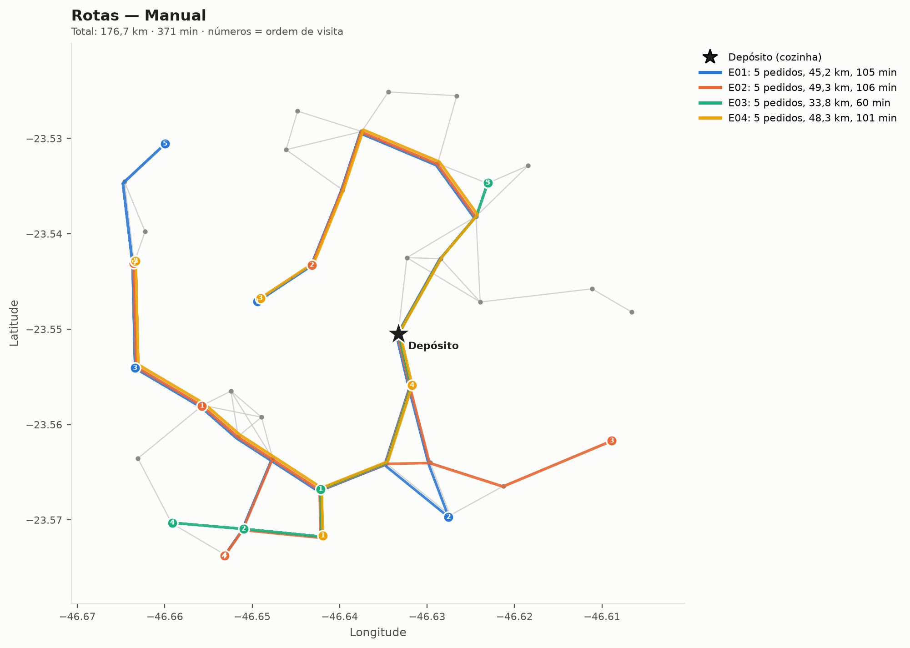 | 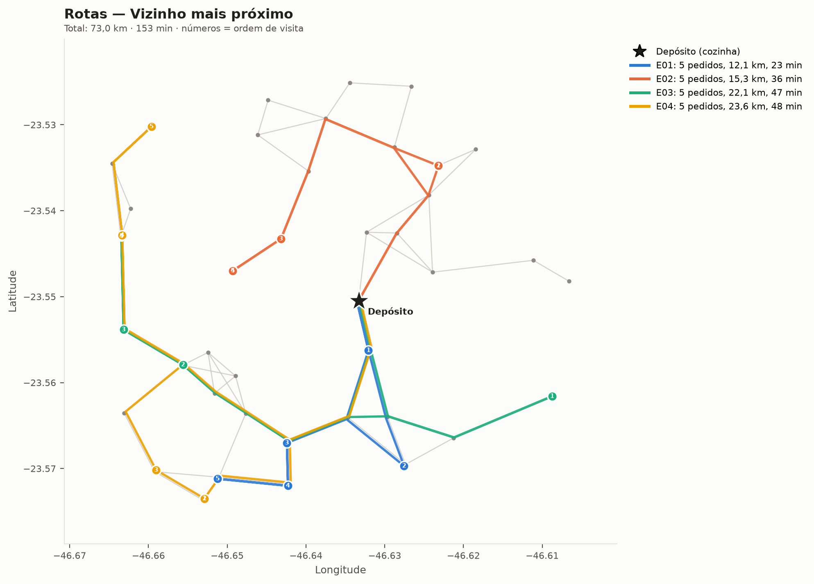 | 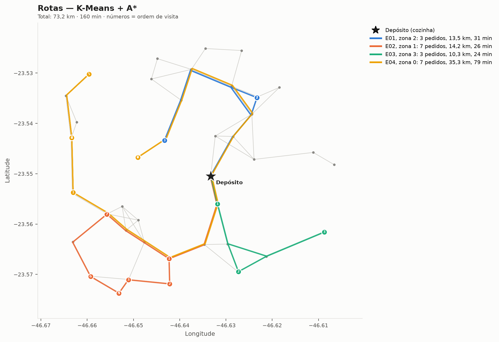 |

## 9. Gráficos

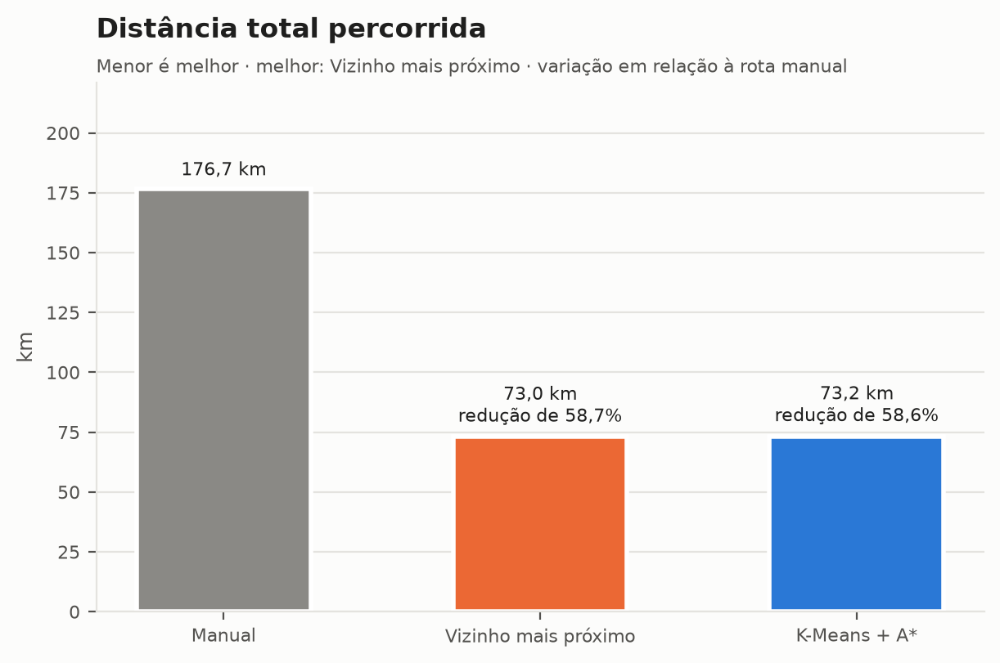

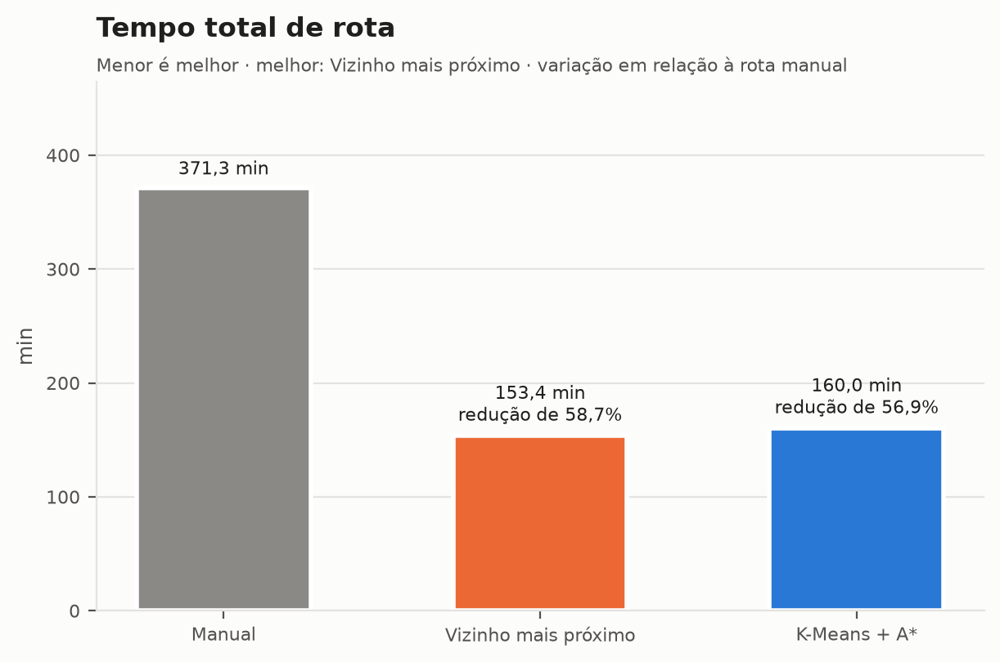

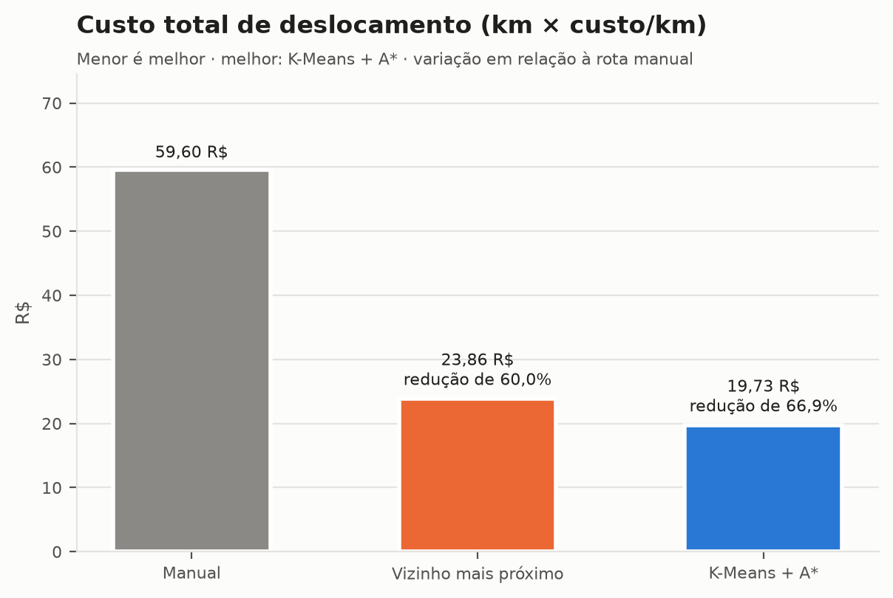

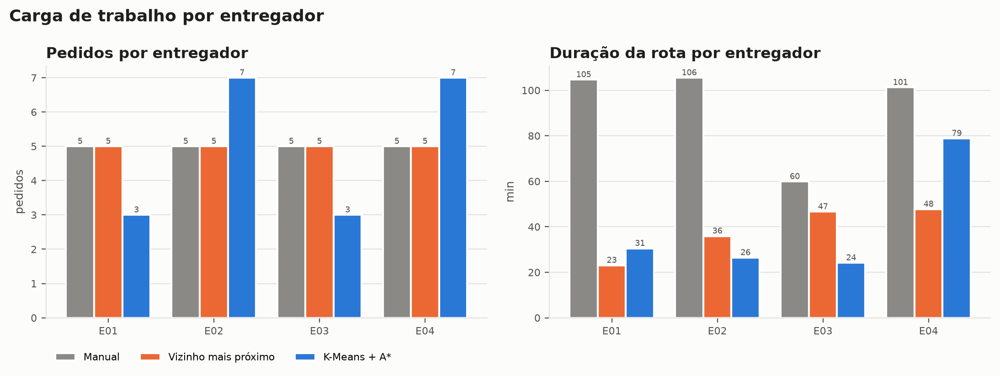

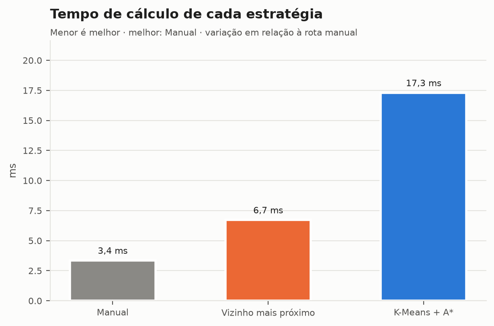

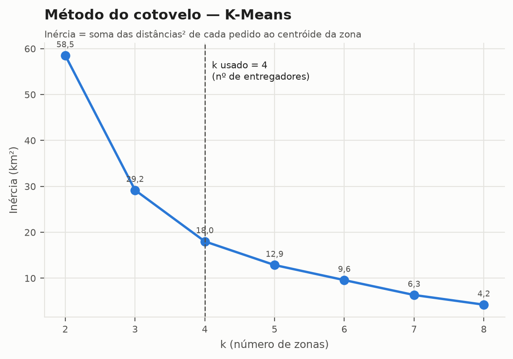

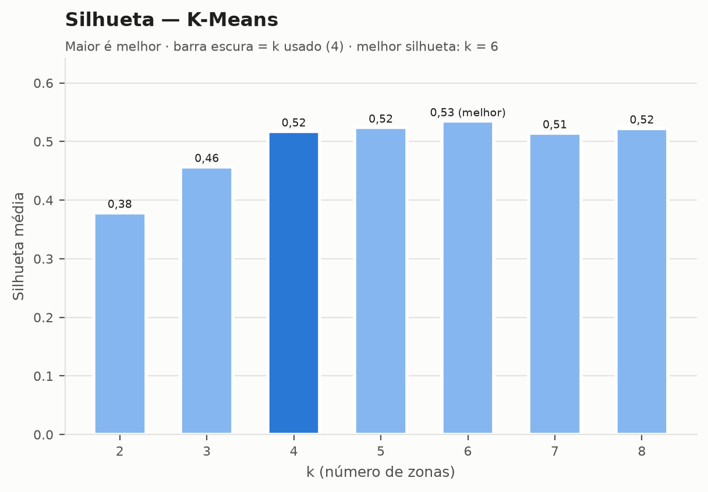

## 10. Limitações

- **O K-Means não conhece a malha viária.** Agrupa por proximidade em linha reta; dois pedidos vizinhos no mapa podem estar longe pelas ruas.
- **O K-Means ignora o depósito.** Uma zona compacta, mas de acesso difícil a partir do depósito, gera uma rota longa.
- **Velocidades fixas por rua**, sem trânsito real, semáforos nem variação por horário.
- **O veículo não muda a velocidade**, por isso a atribuição húngara afeta só o custo em R$.
- **Sem capacidade de carga nem janela de horário** (os campos existem no modelo, mas ainda não são usados).
- **Grafo sintético e pequeno** (40 nós), com dados fictícios.
- **O balanceamento usa o número de pedidos**, não a duração das rotas.

## 11. Sugestões de melhoria

1. **Considerar o depósito no agrupamento:** agrupar por ângulo e distância a partir do depósito (método *sweep*) ou acrescentar essa distância às coordenadas.
2. **Agrupar por distância de rua**, usando K-Medoids sobre a matriz de custos A*.
3. **Trocas entre zonas** após o roteamento (*relocate/exchange*), balanceando pela duração das rotas.
4. **Escolher k pelo custo total** (testar k = 2 a 4) em vez de fixar k = número de entregadores.
5. **Capacidade, prioridade e janelas de horário** (VRP com restrições, ex.: OR-Tools).
6. **Dados reais do OpenStreetMap** e velocidades por horário para representar o pico.
